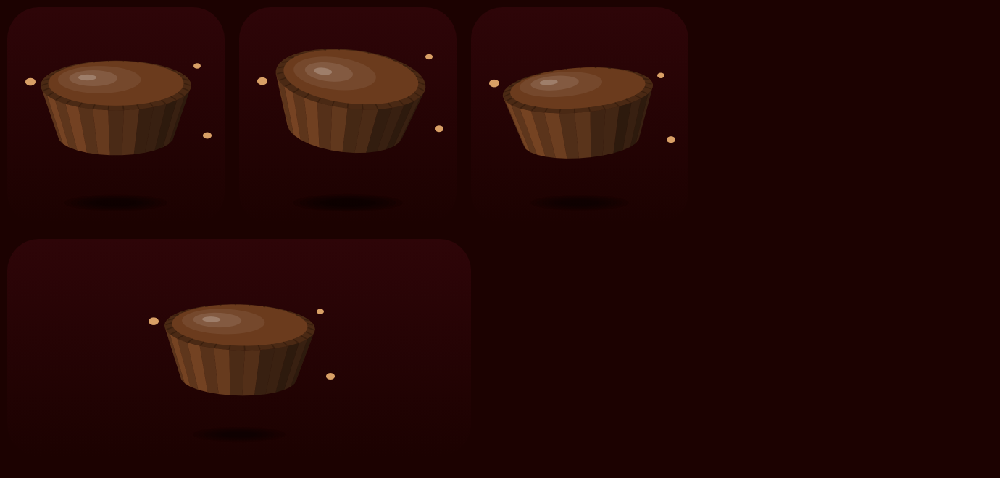
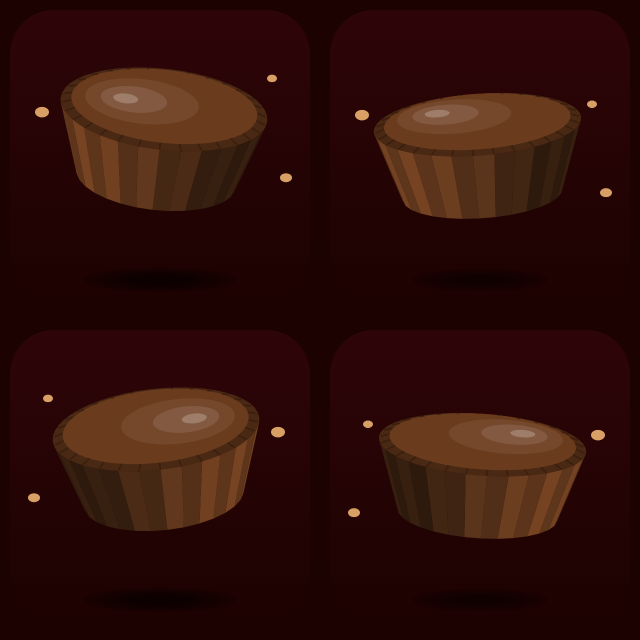
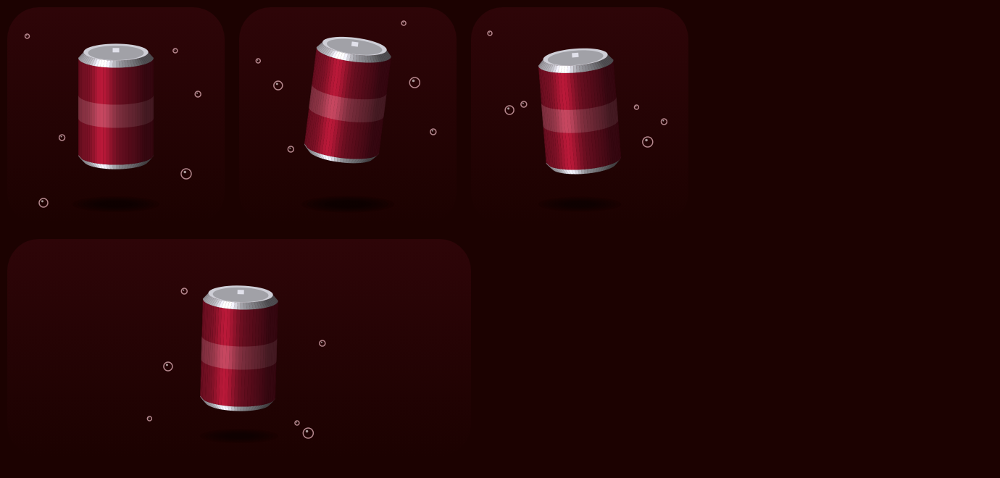

# Duo Widget

A home screen / lock screen widget that counts how many times you open the wide
(inner) screen of a folding iPhone. A Shortcuts automation does the counting;
the widget shows the number.

It is built with [Scriptable](https://scriptable.app) (free), because the
Shortcuts app cannot make custom widgets on its own. Shortcuts runs the script,
and Scriptable draws the widget.

Your count stays on your phone. The script does not use the internet or send
data anywhere.

## What the widget shows

- Total number of times the wide screen was opened
- How many times today
- When it was last opened

## Setup

### 1. Add the script

1. Install **Scriptable** from the App Store.
2. In Scriptable, tap **+** to make a new script.
3. Paste in everything from [`duo-counter.js`](duo-counter.js).
4. Tap the title at the top and name it **Duo Counter**.
5. Tap ▶︎ once. It shows a preview and prints the measured screen ratio in
   the log. Run it once folded and once opened to check that "Wide screen now"
   says `false` and `true` correctly.

### 2. Make the Shortcut

1. Open **Shortcuts** → **+**.
2. Add the action **Scriptable → Run Script**.
3. Choose **Duo Counter**. You don't need to fill in anything else: with
   **Parameter** and **Texts** left empty, it runs `check`. (To use `add`
   or `reset`, add it under **Texts** → **Add New Item**.)
4. Turn **Run In App** and **Show When Run** off.
5. Name the shortcut **Count Wide Screen**.

`check` only counts when the wide screen is showing *and* it wasn't showing the
last time the shortcut ran, so running it several times in a row while open
won't inflate the count.

### 3. Run it automatically

1. Shortcuts → **Automation** → **+** → **Create Personal Automation**.
2. Pick the trigger that fires when you open the phone:
   - If your iOS version offers an unfold / screen-change trigger, use that.
   - Otherwise, a good stand-in is **App → Is Opened** with the apps you
     usually use on the wide screen, or **Display → Is Turned On**
     (if available), so the check runs whenever you start using the phone.
3. Choose **Run Immediately** and turn off **Notify When Run**.
4. Select the **Count Wide Screen** shortcut.

> The exact automation triggers depend on your iOS version and device. The
> script itself works with any trigger, since it checks the screen shape
> each time it runs.

### 4. Add the widget

1. Long-press the home screen → **Edit** → **Add Widget** → **Scriptable**.
2. Pick a size (small or medium) and add it.
3. Long-press the widget → **Edit Widget** → set **Script** to **Duo Counter**.

It also works as a lock screen widget (circular, rectangular, or inline).

## Shortcut parameters

| Parameter | What it does |
|-----------|--------------|
| `check`   | Counts +1 if the wide screen just became visible (the default when nothing is filled in) |
| `add`     | Always counts +1 (handy for a manual button) |
| `reset`   | Sets the count back to 0 |

The shortcut returns the new total, so you can follow it with **Show Result**
if you want to see the number.

## Notes

- **Widget refresh timing is controlled by iOS.** The count is saved instantly,
  but the widget may take a few minutes to show the new number.
- If the wide screen isn't detected correctly, open the script and change
  `WIDE_RATIO_MAX` near the top (the log from step 1.5 shows your ratio).

---

# Peanut Butter Cup widget

A second, just-for-fun widget: a 3D peanut butter cup floating over a very dark maroon
background.

iOS widgets are still pictures, so the cup can't move continuously. Each time
iOS refreshes the widget, the cup is drawn at a slightly different height, tilt
and turn, so it drifts around through the day.

**Battery:** it draws one small picture per refresh, with no internet, location
or sensors, and asks for a refresh only every 30 minutes (iOS may wait longer).
You can change `REFRESH_MINUTES` near the top of the script.

## Setup

1. In Scriptable, tap **+**, paste in everything from
   [`peanut-butter-cup.js`](peanut-butter-cup.js), name it **Peanut Butter Cup**,
   and tap **Done**.
2. Press and hold the home screen → **Edit** → **Add Widget** → **Scriptable**,
   pick **Small** or **Medium**, and add it.
3. Press and hold the widget → **Edit Widget** → set **Script** to
   **Peanut Butter Cup**.

No Shortcut is needed for this one.

## Use a real photo

You can float your own photo instead of the drawn cup:

1. Take a photo of a peanut butter cup (or find one in your Photos).
2. Open it in **Photos** and press and hold on the cup until it lights up,
   then tap **Share** → **Save to Files**. This saves just the cup with a
   see-through background.
3. Save it into **iCloud Drive → Scriptable** (or **On My iPhone → Scriptable**)
   and rename it to **cup.png**.

The widget picks it up on its next refresh. Delete or rename the file to go
back to the drawn cup. The photo stays on your phone and is not part of this
repo.

**Photo not showing?** Open the script in Scriptable and tap ▶︎. The log at
the bottom lists the pictures it can see in each Scriptable folder and which
one it's using. Names like `cup.png`, `Cup.PNG`, `cup.png.png`, `cup.jpg` and
`cup.heic` all work.

Widgets can't rotate pictures, so a photo floats by moving up and down,
drifting sideways and growing slightly as it rises. It doesn't tilt like the
drawn cup.

---

# Peanut Butter Cup (Flipped) widget

A separate copy of the peanut butter cup widget that faces the other way: the
cup tilts, turns, drifts and is lit from the opposite side, and the crumbs are
mirrored. Use it on its own or next to the original for a matching pair.

## Setup

1. In Scriptable, tap **+**, paste in everything from
   [`peanut-butter-cup-flipped.js`](peanut-butter-cup-flipped.js), name it
   **Peanut Butter Cup Flipped**, and tap **Done**.
2. Add a Scriptable widget to the home screen and set its **Script** to
   **Peanut Butter Cup Flipped**.

## Flipping your photo

Nothing extra to do: this widget uses the same `cup.png` as the original and
mirrors it for you. Widgets themselves can't mirror pictures, so the
mirroring happens the first time the script runs in the Scriptable app. Either
tap ▶︎ on the script in Scriptable, or just tap the widget once (that opens and
runs it). The mirrored copy is saved and reused, and it's remade automatically
if you replace `cup.png`.

Mirroring flips everything, so any writing on the wrapper reads backwards.

---

# Dr Pepper widget

A soda can floating among rising bubbles, on the same dark maroon background
as the peanut butter cup widget. Without a photo it draws a plain burgundy can
(no logo); add your own photo to show the real thing.

## Setup

1. In Scriptable, tap **+**, paste in everything from
   [`dr-pepper.js`](dr-pepper.js), name it **Dr Pepper**, and tap **Done**.
2. Add a Scriptable widget to the home screen and set its **Script** to
   **Dr Pepper**.

## Use a real photo

1. In **Photos**, press and hold on the can or bottle until it lights up, then
   tap **Share** → **Save to Files**.
2. Save it in **iCloud Drive → Scriptable** (or **On My iPhone → Scriptable**)
   and name it **drpepper.png**. Names like `Dr Pepper.png` or
   `dr-pepper.jpg` work too.

Run the script in Scriptable to check: the log says which picture it's using.
